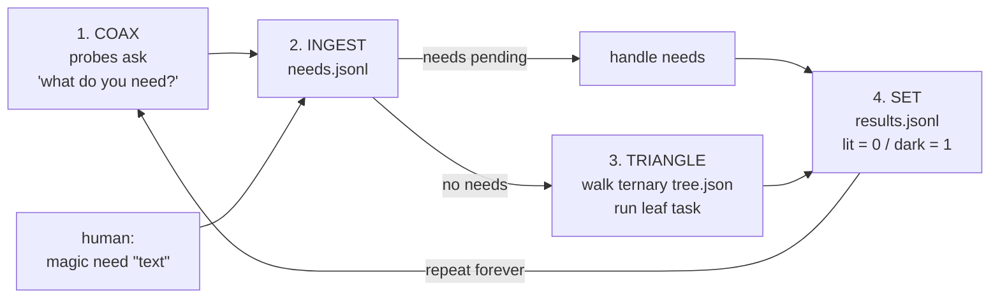
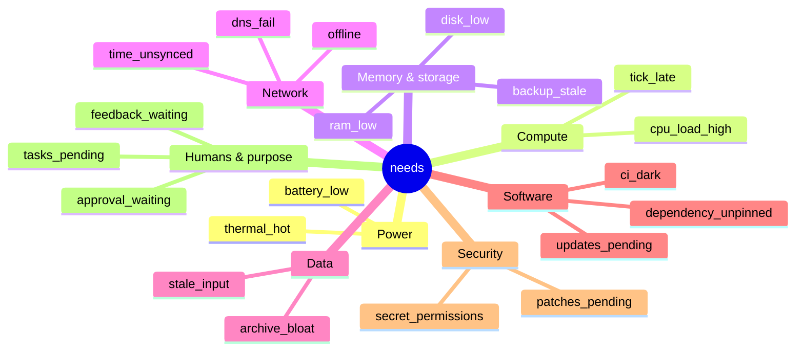
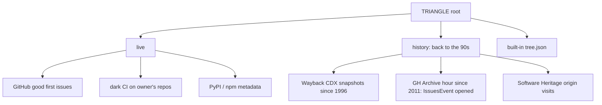

# magic-ingestion

**The computer types up its own needs.**

A tiny Python 3 (stdlib only) loop that asks the machine *"what do you need?"*, writes the answers down itself, and — when nothing is needed — walks a ternary tree of safe default chores. Every result is marked **lit** (success, `0`) or **dark** (failure, `1`) — active-low.

## The loop



0. Loop: COAX → INGEST → SOLVE (needs) or TRIANGLE (no needs) → SET.
1. **COAX** — probes: disk space low, stale files older than N hours, an external queue file with pending items, and an optional CI command whose nonzero exit means the CI light is dark.
2. **INGEST** — each fired probe becomes a plain-text line in `needs.jsonl` (`ts`, `source`, `text`). Need text is data only — logged, never executed.
3. **TRIANGLE** — with no needs, walk `tree.json` (exactly 3 branches per node). Branch choice is a deterministic rotation: `cycle + seed` in base 3, so all 9 leaves are visited every 9 cycles. Leaf tasks: `tidy_temp`, `summarize_log`, `self_test`.
4. **SET** — append to `results.jsonl` with `code` 0/1 and `light` lit/dark. Then start over.

## Needs map: 8 families (COAX)

Every need is tagged with a family and a kind (`magic_ingestion/needs-map.json`). One COAX probe per family. Probes are read-only, Linux-friendly, and skip quietly when a source is missing (`sys_root` lets tests mock `/proc`, `/sys`, `/var`).



Security probes only `stat()` secret files for permissions; **contents are never read**. Network probes are off unless `dns_host` / `net_check` are set. Internet and history candidates are tagged with a family too (keyword match, with a per-source default).

## SOLVE

After COAX/INGEST, each pending need is matched to a solution in `magic_ingestion/solutions.json`:

| Mode | Kinds | What happens |
|---|---|---|
| **auto** (safe, reversible, workdir-only) | `disk_low` → tidy tmp + rotate logs; `stale_input` → refresh cache (old copy kept as `.bak`); `tick_late` → self-test; `tasks_pending`, `feedback_waiting`, `approval_waiting`, `human_need` → acknowledge in log; `probe_error` → acknowledge + self-test | run now, result lit/dark |
| **propose** (risky) | `battery_low`, `thermal_hot`, `cpu_load_high`, `ram_low`, `backup_stale`, `offline`, `dns_fail`, `time_unsynced`, `archive_bloat`, `updates_pending`, `dependency_unpinned`, `ci_dark`, `patches_pending`, `secret_permissions` | exact steps appended to `proposals.jsonl` with status `awaiting approval`; **never executed** |

Dark CI on the owner's repos only ever gets the throwaway-fork-branch plan: fork → disposable branch → smallest fix → prove the fork lit → upstream PR only with the owner's OK. Magic never pushes.

## Internet tasks (TRIANGLE, optional)

With `--source live|history|all` (or `"source"` in `magic.json`), TRIANGLE first fetches candidate tasks from the internet, then falls back to the built-in tree if offline or nothing is found. The root becomes a ternary node:



Each branch's candidates are grouped into sub-trees with 3 children per node; empty branches fall back to the built-in tree. Examples: *"review archived page http://example.com/ from 1998"*, *"old issue from 2012: …"*, *"CI light is dark on owner/repo"*.

- **Read-only.** Only HTTPS GETs to public APIs. Nothing is ever posted, commented, or contacted. Picking a candidate just appends it to `internet_tasks.jsonl` (lit). Fetched text is stored as data and **never executed**.
- No auth needed; `GITHUB_TOKEN` (optional) is sent only to `api.github.com` for higher rate limits.
- Cached in `candidates.json` in the workdir (`cache_ttl`, default 1h), deduped by id, rate-limited (`rate_limit` seconds between requests), with `timeout` per request. A failing source is skipped and listed as dark in `magic fetch` output.

```sh
magic fetch            # live + history into the cache
magic fetch --live
magic fetch --history
magic run --source all
```

Config keys: `source`, `owner`, `pypi_packages`, `npm_packages`, `wayback_urls`, `wayback_from` / `wayback_to` (CDX date range, e.g. `"1996"`–`"1999"`), `wayback_limit`, `wayback_collapse` (default `timestamp:4`, one snapshot per year), `gharchive_hour` (e.g. `"2012-03-10-15"`), `swh_origins`, `cache_ttl`, `rate_limit`, `timeout`.

Tests mock all network; CI never touches the internet.

## Usage

```sh
pip install -e .
magic need "back up the notes folder"   # a human types a need
magic once                               # one cycle (exit 0 lit, 1 dark)
magic run --interval 60                  # loop forever (or: magic run --once)
magic status                             # pending needs, lit/dark counts
```

All state lives in `--workdir` (default `.magic`, or `$MAGIC_WORKDIR`). Optional `magic.json` there:

```json
{"min_free_bytes": 104857600, "stale_hours": 24, "stale_files": ["notes.txt"],
 "queue_file": "inbox.txt", "ci_command": ["gh", "run", "list", "-L", "1"], "seed": 0}
```

## Safety

- Tasks only touch the working dir; paths are checked so they can't escape it.
- No `shell=True` anywhere; the CI command is an argv list.
- Human need text is recorded, never run.

## Pairs with

- The **Lex loop** (READ → … → RESTART robot ROM): magic-ingestion supplies the READ step's "what's needed".
- **[tick-sandbox](https://github.com/fitzyracing1/tick-sandbox)** supervisor: run `magic run` under it to keep the loop alive and sandboxed.

## Tests

```sh
pip install pytest && pytest -v
```

No license file yet — pending owner review.
