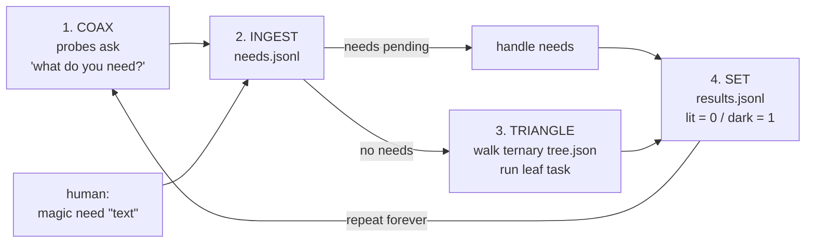

# magic-ingestion

**The computer types up its own needs.**

A tiny Python 3 (stdlib only) loop that asks the machine *"what do you need?"*, writes the answers down itself, and — when nothing is needed — walks a ternary tree of safe default chores. Every result is marked **lit** (success, `0`) or **dark** (failure, `1`) — active-low.

## The loop



1. **COAX** — probes: disk space low, stale files older than N hours, an external queue file with pending items, and an optional CI command whose nonzero exit means the CI light is dark.
2. **INGEST** — each fired probe becomes a plain-text line in `needs.jsonl` (`ts`, `source`, `text`). Need text is data only — logged, never executed.
3. **TRIANGLE** — with no needs, walk `tree.json` (exactly 3 branches per node). Branch choice is a deterministic rotation: `cycle + seed` in base 3, so all 9 leaves are visited every 9 cycles. Leaf tasks: `tidy_temp`, `summarize_log`, `self_test`.
4. **SET** — append to `results.jsonl` with `code` 0/1 and `light` lit/dark. Then start over.

## Usage

```sh
pip install -e .
magic need "back up the notes folder"   # a human types a need
magic once                               # one cycle (exit 0 lit, 1 dark)
magic run --interval 60                  # loop forever (or: magic run --once)
magic status                             # pending needs, lit/dark counts
```

All state lives in `--workdir` (default `.magic`, or `$MAGIC_WORKDIR`). Optional `magic.json` there:

```json
{"min_free_bytes": 104857600, "stale_hours": 24, "stale_files": ["notes.txt"],
 "queue_file": "inbox.txt", "ci_command": ["gh", "run", "list", "-L", "1"], "seed": 0}
```

## Safety

- Tasks only touch the working dir; paths are checked so they can't escape it.
- No `shell=True` anywhere; the CI command is an argv list.
- Human need text is recorded, never run.

## Pairs with

- The **Lex loop** (READ → … → RESTART robot ROM): magic-ingestion supplies the READ step's "what's needed".
- **[tick-sandbox](https://github.com/fitzyracing1/tick-sandbox)** supervisor: run `magic run` under it to keep the loop alive and sandboxed.

## Tests

```sh
pip install pytest && pytest -v
```

No license file yet — pending owner review.
